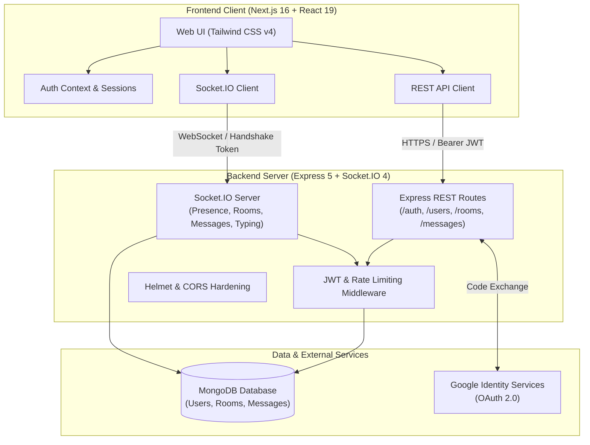

# 💬 Chatly — Full-Stack Real-Time Chat Platform

A production-ready, full-stack real-time messaging application built with **Next.js 16 (App Router), React 19, Tailwind CSS v4, Node.js, Express 5, TypeScript, Socket.IO 4, and MongoDB (Mongoose 9)**.

---

## 🌟 Overview & Architecture

Chatly is built as a modular monorepo consisting of two distinct services:
1. **[`/web`](./web)**: A modern Next.js 16 web application with React 19, Tailwind CSS v4, and real-time Socket.IO integration.
2. **[`/server`](./server)**: A robust REST API and WebSocket server built with Express 5, TypeScript, Socket.IO, and MongoDB.

### Architecture Diagram



---

## ✨ Core Features

| Feature | Description |
|---|---|
| **⚡ Real-Time Messaging** | Sub-millisecond message delivery and broadcasting powered by Socket.IO with automatic reconnects and acknowledgement callbacks. |
| **💬 Direct & Group Chats** | Instant 1-on-1 private messaging (with idempotent room discovery) and multi-user group channels with administrator roles. |
| **🟢 Live Online Presence** | In-memory presence tracker broadcasting real-time online/offline status dots across the application. |
| **✍️ Live Typing Indicators** | Throttled typing broadcast notifications ("Alice is typing...") with automatic reset timers. |
| **🔔 Unread Message Tracking** | Dynamic unread counter badges per conversation with automatic read-receipt synchronization (`lastReadAt`). |
| **📜 Cursor-Based Pagination** | Scalable MongoDB compound indexing (`{ roomId: 1, _id: -1 }`) supporting infinite history scrolling without performance degradation. |
| **🔐 Multi-Provider Authentication** | Secure email/password authentication (bcrypt hashing + signed JWTs) alongside Google OAuth 2.0 with popup and redirect fallbacks. |
| **🛡️ Production Hardening** | Helmet HTTP header protection, dynamic CORS validation, Zod request sanitization, and tiered rate limits for auth, REST, and sockets. |
| **📱 Responsive Tailwind UI** | Tailwind CSS v4 with custom dark/light surface tokens, Material Symbols, and mobile drawer transitions. |

---

## 📁 Repository Structure

```
ChatApp/
├── server/                     # Backend REST API and WebSocket service
│   ├── src/
│   │   ├── config/             # Environment variables and MongoDB connection
│   │   ├── controllers/        # Express route controllers (Auth, User, Room, Message)
│   │   ├── middleware/         # Auth, validation, rate limiting, and error handling
│   │   ├── models/             # Mongoose schemas (User, Room, Message)
│   │   ├── routes/             # Express API route declarations
│   │   ├── services/           # Business logic and database operations
│   │   ├── sockets/            # Socket.IO handlers, authentication, and presence
│   │   ├── utils/              # Seed scripts, test utilities, logger, validators
│   │   ├── app.ts              # Express application configuration
│   │   └── index.ts            # HTTP & Socket.IO server entrypoint
│   ├── .env.example            # Backend environment template
│   ├── package.json            # Backend scripts and dependencies
│   ├── tsconfig.json           # Backend TypeScript configuration
│   └── README.md               # Backend documentation & API reference
├── web/                        # Frontend Next.js application
│   ├── app/
│   │   ├── chat/page.tsx       # Live chat dashboard (rooms, chat pane, modals)
│   │   ├── login/page.tsx      # Login page with credentials and Google Sign-In
│   │   ├── register/page.tsx   # User registration with avatar support
│   │   ├── page.tsx            # Landing page with interactive live demo modal
│   │   ├── layout.tsx          # Root layout and AuthContext provider
│   │   └── globals.css         # Tailwind CSS v4 rules & color palettes
│   ├── lib/
│   │   ├── api.ts              # Typed REST client with JWT header injection
│   │   ├── auth-context.tsx    # Auth state management and persistent session
│   │   ├── google-auth.ts      # Google OAuth URL builders and handlers
│   │   ├── socket.ts           # Socket.IO client singleton
│   │   └── types.ts            # Shared TypeScript types
│   ├── .env.example            # Frontend environment template
│   ├── package.json            # Frontend scripts and dependencies
│   ├── next.config.ts          # Next.js configuration
│   └── README.md               # Frontend documentation & guide
├── ChatApp.md                  # Initial implementation design specification
└── README.md                   # Project documentation (this file)
```

---

## 🚀 Quickstart & Local Setup

Follow these steps to run both backend and frontend on your local machine:

### 1. Prerequisites
- **Node.js**: v18.0.0 or higher
- **npm**: v9.0.0 or higher
- **MongoDB**: A running local MongoDB instance (`mongodb://localhost:27017/chatapp`) or a free [MongoDB Atlas](https://www.mongodb.com/atlas) cluster.

---

### 2. Backend Setup (`/server`)

1. Open a terminal and navigate to `/server`:
   ```bash
   cd server
   ```

2. Install dependencies:
   ```bash
   npm install
   ```

3. Create your `.env` file (copy from `.env.example`):
   ```bash
   cp .env.example .env
   ```

4. Configure your `.env` variables:
   ```env
   PORT=5000
   MONGODB_URI=mongodb://localhost:27017/chatapp
   CLIENT_URL=http://localhost:3000
   JWT_SECRET=super_secret_jwt_key_development_only
   JWT_EXPIRES_IN=7d
   GOOGLE_CLIENT_ID=your_google_client_id_optional
   GOOGLE_CLIENT_SECRET=your_google_client_secret_optional
   ```

5. Seed the database with sample users and initial rooms:
   ```bash
   npm run seed
   ```
   > **Seed Accounts Created:**
   > - `alice@example.com` / `password123`
   > - `bob@example.com` / `password123`
   > - `charlie@example.com` / `password123`

6. Start the development server:
   ```bash
   npm run dev
   ```
   The backend server will start on `http://localhost:5000` (health check: `http://localhost:5000/health`).

---

### 3. Frontend Setup (`/web`)

1. Open a new terminal tab and navigate to `/web`:
   ```bash
   cd web
   ```

2. Install dependencies:
   ```bash
   npm install
   ```

3. Create your `.env.local` file (copy from `.env.example`):
   ```bash
   cp .env.example .env.local
   ```

4. Verify your `.env.local` configuration:
   ```env
   NEXT_PUBLIC_API_URL=http://localhost:5000
   NEXT_PUBLIC_GOOGLE_CLIENT_ID=your_google_client_id_optional
   ```

5. Start the Next.js development server:
   ```bash
   npm run dev
   ```

6. Open [http://localhost:3000](http://localhost:3000) in your browser.

---

### 4. Testing Multi-User Chat Locally

1. Open [http://localhost:3000/login](http://localhost:3000/login) in a normal browser window and log in as `alice@example.com` (`password123`).
2. Open an Incognito / Private browsing window and log in as `bob@example.com` (`password123`).
3. Select each other's conversation or create a new room to observe:
   - Instant real-time message delivery
   - Live typing alerts
   - Online presence dots
   - Real-time unread badge increments and read confirmations

---

## ⚙️ Environment Variables Reference

### Backend (`/server/.env`)
| Variable | Required | Description | Default |
|---|:---:|---|---|
| `PORT` | No | HTTP and WebSocket server port | `5000` |
| `MONGODB_URI` | **Yes** | MongoDB connection string (Atlas or local) | — |
| `CLIENT_URL` | **Yes** | Client origin used for CORS and OAuth redirects | `http://localhost:3000` |
| `JWT_SECRET` | **Yes** | Secret key for signing JSON Web Tokens | — |
| `JWT_EXPIRES_IN` | No | Expiration period for issued JWTs | `7d` |
| `GOOGLE_CLIENT_ID` | No | Google OAuth 2.0 Web Client ID | — |
| `GOOGLE_CLIENT_SECRET` | No | Google OAuth 2.0 Client Secret | — |

### Frontend (`/web/.env.local`)
| Variable | Required | Description | Default |
|---|:---:|---|---|
| `NEXT_PUBLIC_API_URL` | **Yes** | Base URL for REST API & Socket.IO server | `http://localhost:5000` |
| `NEXT_PUBLIC_GOOGLE_CLIENT_ID` | No | Google OAuth Client ID for frontend sign-in | — |

---

## 📜 Available Scripts

### Backend (`server/`)
- `npm run dev`: Starts the development server with live reload via `tsx watch`.
- `npm run build`: Compiles TypeScript files to the `/dist` directory.
- `npm start`: Runs the compiled production server from `/dist`.
- `npm run seed`: Populates MongoDB with test users and rooms.
- `npm test`: Executes the Vitest integration test suite.
- `npm run test:watch`: Runs Vitest in interactive watch mode.
- `npm run test:auth`: Standalone test script for registration and authentication.
- `npm run test:rooms`: Standalone test script for room management.
- `npm run test:messages`: Standalone test script for messaging and pagination.
- `npm run test:sockets`: Standalone test script for WebSocket events.

### Frontend (`web/`)
- `npm run dev`: Launches the Next.js development server with Turbopack.
- `npm run build`: Generates an optimized production build.
- `npm run start`: Starts the Next.js production server.
- `npm run lint`: Runs ESLint over the frontend codebase.

---

## 🚀 Production Deployment

### 1. Backend Deployment (Render / Railway / Fly.io)
Deploy the `/server` service on a platform that supports persistent WebSocket connections:
1. Root directory: `server`
2. Build command: `npm install && npm run build`
3. Start command: `npm start`
4. Configure environment variables (`MONGODB_URI`, `CLIENT_URL`, `JWT_SECRET`, etc.).

### 2. Frontend Deployment (Vercel)
Deploy the `/web` directory on Vercel:
1. Root directory: `web`
2. Framework preset: `Next.js`
3. Environment variables:
   - `NEXT_PUBLIC_API_URL`: Your deployed backend URL (e.g. `https://your-backend.onrender.com`)
   - `NEXT_PUBLIC_GOOGLE_CLIENT_ID`: Your Google OAuth Client ID

---

## 📖 Additional Documentation

For more in-depth details on each package, see:
- [Server Documentation & API Guide](./server/README.md)
- [Web Client Documentation & Features](./web/README.md)
- [Initial System Architecture Plan](./ChatApp.md)
